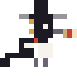
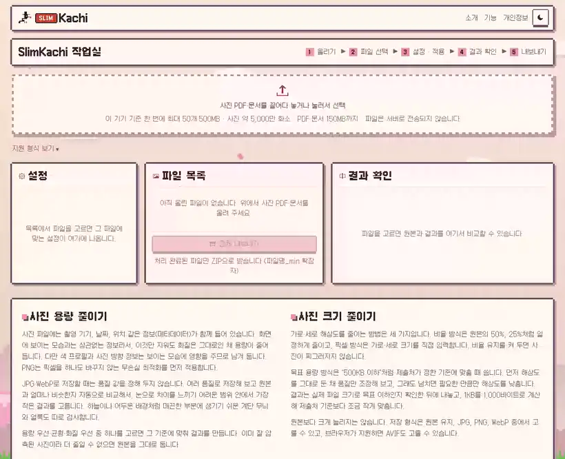
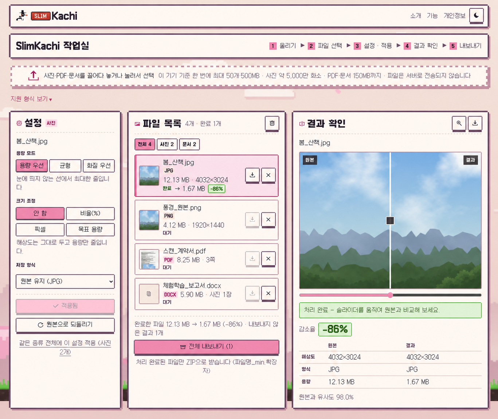
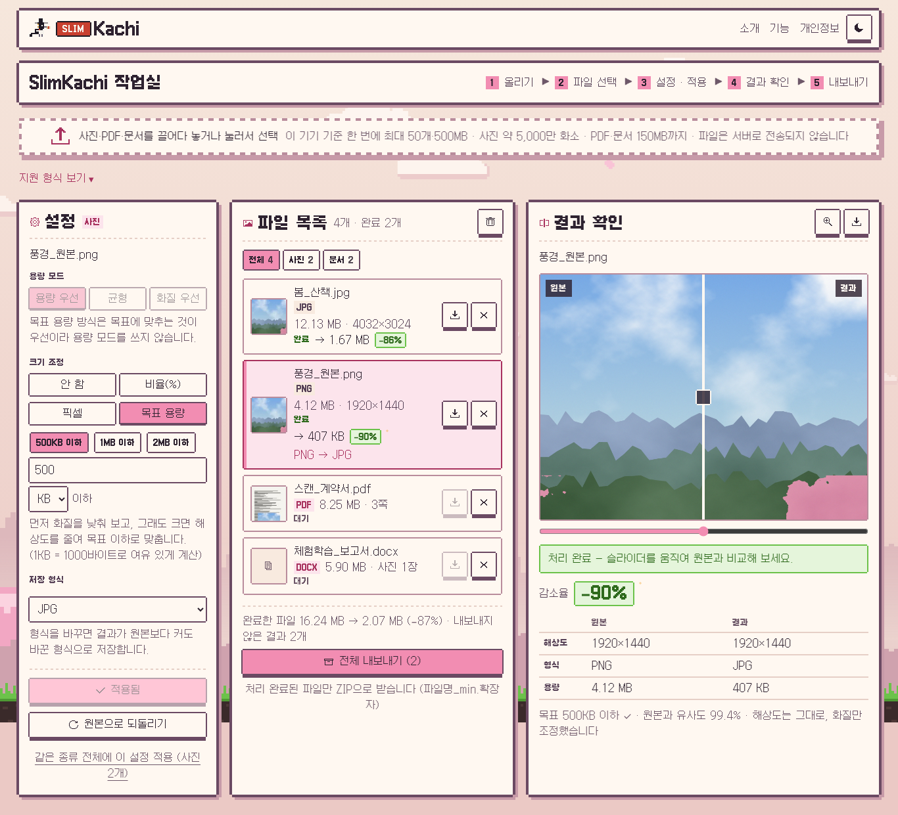
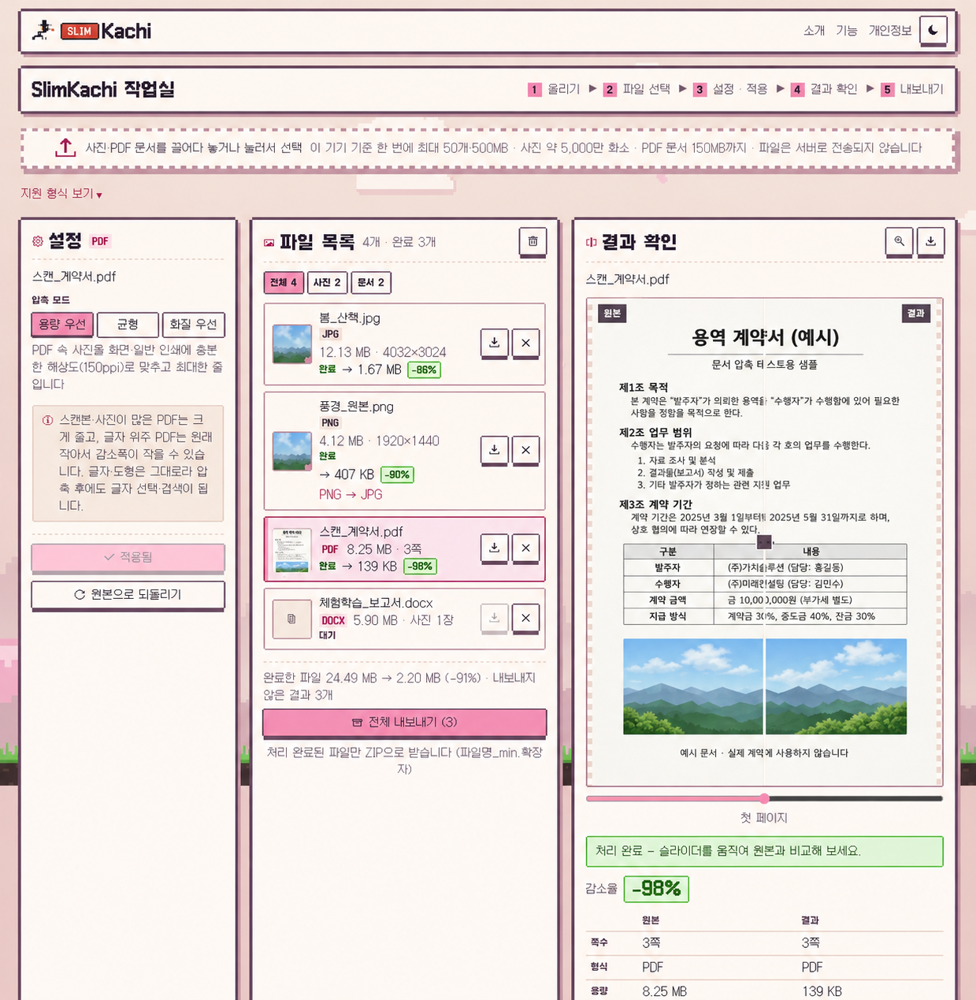
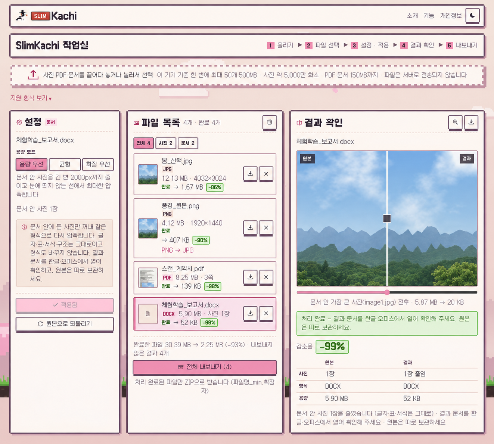
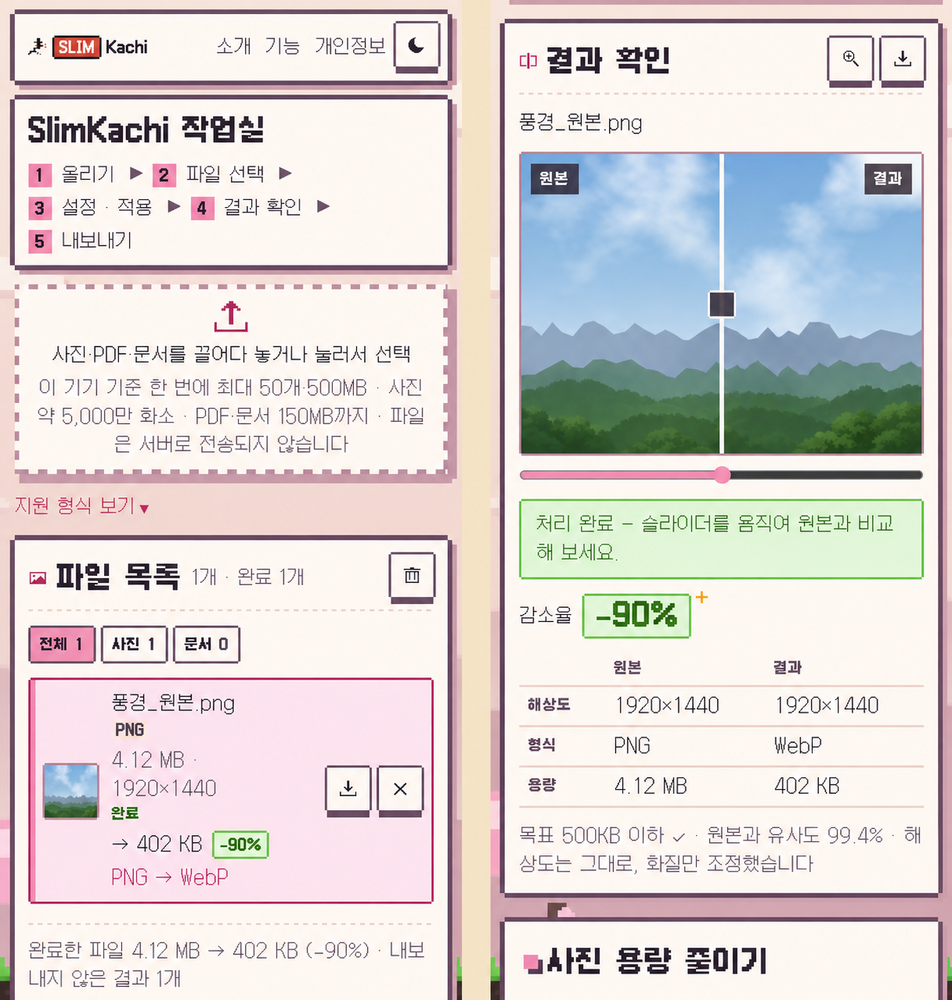
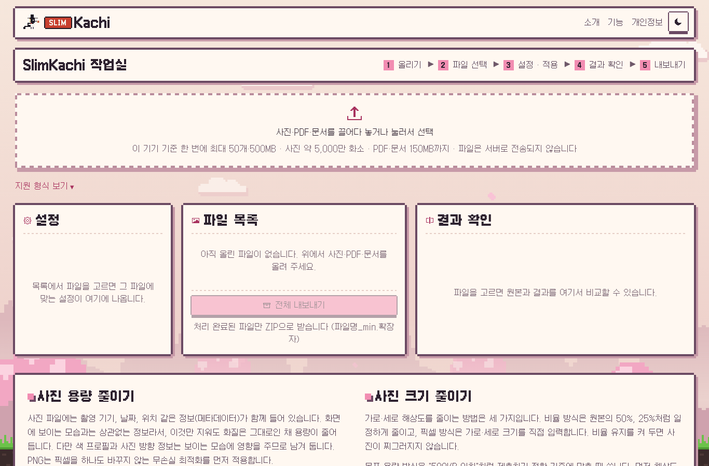
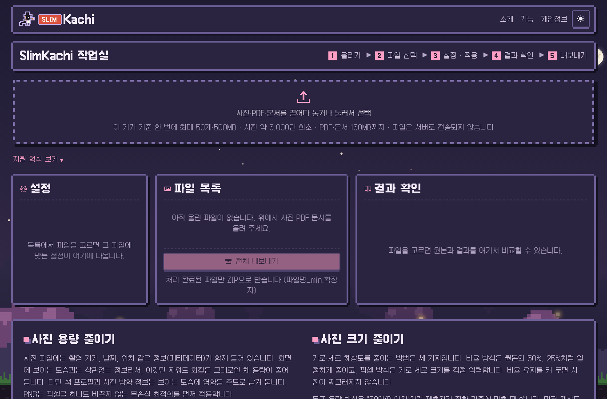

<p align="center">
  
</p>

<h1 align="center">SlimKachi</h1>

<p align="center">
  <b>사진 · PDF · 문서 용량 줄이기</b> — 업로드 없이, 브라우저 안에서, 무료로<br>
  <a href="https://slimkachi.pages.dev"><b>slimkachi.pages.dev</b></a>
</p>

<p align="center">
  
</p>
<p align="center"><sub>실제 작동 화면 — 12MB 사진을 올리고 [적용]을 누르면 1.67MB(−86%)로 줄어들고, 슬라이더로 원본과 바로 비교할 수 있습니다. (처리 구간은 빠르게 재생)</sub></p>

---

## 목차

- [SlimKachi는](#slimkachi는)
- [사용 방법 — 5단계](#사용-방법--5단계)
- [기능 둘러보기](#기능-둘러보기)
  - [사진 압축](#1-사진-압축--화질은-그대로-용량만)
  - [목표 용량 맞추기 · 형식 변환](#2-목표-용량-맞추기--형식-변환)
  - [PDF 압축](#3-pdf-압축--글자는-그대로-이미지만)
  - [문서 압축 (한글 · 워드 · 파워포인트 · 엑셀)](#4-문서-압축--한글--워드--파워포인트--엑셀)
  - [모바일](#5-모바일)
- [어떻게 화질을 지키나](#어떻게-화질을-지키나)
- [지원 형식](#지원-형식)
- [업로드 한도](#업로드-한도)
- [낮 · 밤 테마](#낮--밤-테마)
- [마스코트](#마스코트)
- [브랜드 컬러](#브랜드-컬러)
- [기술 구성](#기술-구성)
- [개인정보](#개인정보)

---

## SlimKachi는

SlimKachi(슬림까치)는 **파일을 서버로 보내지 않고, 지금 쓰는 브라우저 안에서만** 용량을 줄이는 웹 도구입니다.

- **업로드 없음** — 압축은 모두 내 기기에서 일어납니다. 신분증 사진이나 계약서처럼 남에게 보이기 싫은 파일도 그대로 줄일 수 있습니다.
- **화질 먼저** — 품질 값을 하나로 정해 두지 않고, 여러 번 저장해 보면서 원본과 얼마나 비슷한지 직접 비교해 고릅니다.
- **한 화면에서 끝** — 사진, PDF, 문서를 한꺼번에 올리고 → 파일마다 설정하고 → 결과를 비교한 뒤 → ZIP 하나로 받습니다.
- **가입 · 설치 · 워터마크 없음**

---

## 사용 방법 — 5단계

화면 위쪽의 `1 올리기 ▶ 2 파일 선택 ▶ 3 설정·적용 ▶ 4 결과 확인 ▶ 5 내보내기` 순서 그대로입니다.

| 단계 | 하는 일 |
|---|---|
| **1. 올리기** | 점선 상자에 파일을 끌어다 놓거나 눌러서 고릅니다. 사진·PDF·문서를 섞어 올려도 됩니다. |
| **2. 파일 선택** | 가운데 **파일 목록**에서 처리할 파일을 누릅니다. `전체 / 사진 / 문서` 칩으로 목록을 걸러 볼 수 있습니다. |
| **3. 설정 · 적용** | 왼쪽 **설정**에서 모드(용량 우선 · 균형 · 화질 우선), 크기, 저장 형식을 고르고 **[적용]** 을 누릅니다. 같은 종류 파일 전체에 한 번에 적용할 수도 있습니다. |
| **4. 결과 확인** | 오른쪽 **결과 확인**에서 가운데 막대를 좌우로 끌어 원본과 결과를 비교합니다. 돋보기 버튼을 누르면 실제 크기로 볼 수 있습니다. |
| **5. 내보내기** | 파일마다 받거나, **[전체 내보내기]** 로 처리한 파일을 ZIP 하나로 받습니다. 파일 이름은 `원래이름_min.확장자` 입니다. |

---

## 기능 둘러보기

> 아래 숫자는 모두 이 README를 만들면서 **실제 사이트에 예시 파일을 넣어 돌린 결과**입니다.
> 감소율은 파일에 따라 크게 다릅니다. 이미 잘 압축된 파일은 덜 줄고, 더 줄일 수 없으면 원본을 그대로 둡니다.

### 1. 사진 압축 — 화질은 그대로, 용량만

<p align="center">
  
</p>

| 항목 | 원본 | 결과 |
|---|---|---|
| 해상도 | 4032×3024 | 4032×3024 (그대로) |
| 형식 | JPG | JPG |
| 용량 | 12.13 MB | **1.67 MB (−86%)** |
| 원본과 유사도 | — | 98.0% |

- **해상도는 건드리지 않고** 용량만 줄였습니다. 휴대폰으로 찍은 사진 크기 그대로입니다.
- 결과 화면 맨 아래의 **원본과 유사도**는 두 이미지가 구조적으로 얼마나 닮았는지(SSIM)를 보여 줍니다.
- 촬영 기기, 날짜, 위치 같은 **메타데이터는 지우고**, 보이는 모습에 영향을 주는 색 프로필과 사진 방향 정보는 남깁니다.
- PNG는 픽셀을 하나도 바꾸지 않는 **무손실 최적화**를 먼저 시도합니다.

| 모드 | 이럴 때 |
|---|---|
| 용량 우선 | 눈에 띄지 않는 선에서 최대한 작게 |
| 균형 | 용량과 화질의 중간 |
| 화질 우선 | 원본과 거의 구별되지 않게 |

### 2. 목표 용량 맞추기 · 형식 변환

<p align="center">
  
</p>

"사진은 500KB 이하로 제출하세요" 같은 조건이 있을 때 쓰는 기능입니다.

| 항목 | 원본 | 결과 |
|---|---|---|
| 해상도 | 1920×1440 | 1920×1440 (그대로) |
| 형식 | PNG | **JPG** |
| 용량 | 4.12 MB | **407 KB (−90%)** |
| 목표 | — | 500KB 이하 ✓ · 유사도 99.4% |

- **크기 조정** 방식은 네 가지입니다: `안 함` · `비율(%)` · `픽셀(1920 / 1280 / 1080 SNS / 800px 바로 고르기)` · `목표 용량(500KB / 1MB / 2MB 또는 직접 입력)`
- 목표 용량은 **먼저 화질만 낮춰 보고, 그래도 넘치면 필요한 만큼만 해상도를 줄입니다.** 위 예시는 해상도를 줄이지 않고도 목표 안에 들어왔습니다.
- 1KB를 1,000바이트로 계산해서 제출처 기준보다 살짝 작게 맞춥니다. 사이트마다 1KB 계산이 달라도 걸리지 않게 하려는 것입니다.
- **저장 형식**: `원본 유지` · `JPG` · `PNG(무손실)` · `WebP` · `AVIF`(브라우저가 지원할 때)
- 투명 배경을 JPG로 바꿀 때는 채울 색을 고를 수 있고, 형식을 바꿔서 오히려 커지면 결과 화면에 알려 줍니다.

### 3. PDF 압축 — 글자는 그대로, 이미지만

<p align="center">
  
</p>

| 항목 | 원본 | 결과 |
|---|---|---|
| 쪽수 | 3쪽 | 3쪽 |
| 안의 이미지 | 300ppi | 150ppi (용량 우선) |
| 용량 | 8.25 MB | **139 KB (−98%)** |

- PDF 용량의 대부분은 보통 안에 든 **스캔 이미지와 사진**입니다. 이것만 알맞은 해상도로 줄이고 다시 압축합니다.
- **페이지를 통째로 그림으로 바꾸지 않습니다.** 그래서 압축 후에도 글자를 선택하고 검색할 수 있습니다.
- 모드별 이미지 해상도: 용량 우선 **150ppi** · 균형 **200ppi** · 화질 우선 **300ppi**
- 글자 위주의 PDF는 원래 작아서 감소 폭이 작고, 거의 줄지 않으면 원본을 그대로 둡니다.

### 4. 문서 압축 — 한글 · 워드 · 파워포인트 · 엑셀

<p align="center">
  
</p>

| 항목 | 원본 | 결과 |
|---|---|---|
| 문서 안 사진 | 1장 | 1장 (압축됨) |
| 형식 | DOCX | DOCX (그대로) |
| 용량 | 5.90 MB | **52 KB** |

- 문서가 큰 이유는 대부분 **붙여 넣은 사진** 때문입니다. 휴대폰 사진을 그대로 넣으면 한 장에 몇 MB씩 차지합니다.
- 문서 안의 사진만 꺼내 **같은 형식(JPG는 JPG, PNG는 PNG)** 으로 다시 압축한 뒤 제자리에 넣습니다.
- **글자 · 표 · 서식 · 쪽 구성은 건드리지 않고**, 한글을 PDF로 바꾸는 식의 형식 변환도 하지 않습니다. 문서 속 사진이 보이는 크기와 배치도 그대로입니다.
- 지원: **HWP(한글 5.0)** · **HWPX** · **DOCX** · **PPTX** · **XLSX**
- 암호가 걸린 문서, 배포용 문서, DRM 보안 문서는 손대지 않고 안내만 합니다.
- 결과 문서는 한글이나 오피스에서 한 번 열어 확인하고, 원본은 따로 보관해 주세요.

> 예시 문서의 사진은 테스트용으로 만든 매끈한 그림이라 유난히 많이 줄었습니다. 실제 사진이 든 문서는 보통 이보다 덜 줄어듭니다.

### 5. 모바일

<p align="center">
  
</p>

휴대폰 브라우저에서도 똑같이 동작합니다. 세 칸이 위아래로 쌓이고, 처리 속도는 기기 성능에 따라 달라집니다.
(위 화면: PNG 4.12MB → WebP 402KB, 목표 500KB 이하)

---

## 어떻게 화질을 지키나

1. **여러 품질로 저장해 봅니다.** JPG·WebP는 품질 값을 바꿔 가며 실제로 인코딩합니다.
2. **원본과 비교합니다.** 저장한 결과를 다시 열어 원본과의 SSIM(구조적 유사도)을 잽니다.
   - 사진 전체의 **평균**만 보지 않고, 가장 많이 망가진 **부분**도 따로 봅니다.
   - 하늘이나 어두운 배경처럼 매끈한 곳에 생기기 쉬운 **계단 무늬(블록)와 얼룩**도 검사합니다.
3. **기준을 넘는 것 중 가장 작은 결과**를 고릅니다. 기준은 모드(용량 우선 · 균형 · 화질 우선)와 사진 크기에 따라 달라집니다.
4. **원본보다 크면 원본을 그대로 둡니다.** (형식을 바꾼 경우는 예외. 바뀐 형식이 필요한 것이므로 결과를 드리고 늘었다고 알려 줍니다.)

압축 엔진은 MozJPEG, libwebp, libavif, OxiPNG를 WebAssembly로 돌립니다. 무거운 작업은 Web Worker에서 하기 때문에 처리 중에도 화면이 멈추지 않습니다.

---

## 지원 형식

| 종류 | 받는 형식 | 저장 |
|---|---|---|
| 사진 | JPG · PNG · WebP | 같은 형식 그대로 또는 원하는 형식 |
| 사진 (브라우저가 여는 형식) | BMP · GIF · ICO · AVIF | BMP → PNG, GIF·ICO → PNG (움직이는 GIF는 첫 장면) |
| 사진 (전용 변환기) | HEIC · HEIF (아이폰) · TIFF | HEIC → JPG, TIFF → PNG |
| PDF | PDF | PDF |
| 문서 | HWP · HWPX · DOCX · PPTX · XLSX | 같은 형식 |

- 확장자만 보고 거르지 않고, **실제로 열어 보고** 열리면 처리합니다.
- HEIC · TIFF 변환기는 그런 파일을 올렸을 때만 내려받고, 변환도 내 기기 안에서 합니다.
- SVG 같은 벡터 그림은 아직 지원하지 않습니다.

---

## 업로드 한도

저사양 PC(Intel i5-6500 · RAM 4GB)에서도 탭이 멈추지 않도록, **올리기 전에** 위험한 파일을 걸러 냅니다.
사진은 파일 머리(헤더)만 읽어 `가로 × 세로 × 4 × 3` 으로 처리 중 필요한 메모리를 미리 계산합니다.

| | 기본 (모든 기기) | 메모리 8GB 이상 기기 |
|---|---|---|
| 한 번에 올리는 개수 | 30개 | 50개 |
| 목록 전체 용량 | 300 MB | 500 MB |
| 사진 한 장 | 약 2,500만 화소 | 약 5,000만 화소 |
| PDF · 문서 한 개 | 80 MB | 150 MB |

한도를 넘는 파일은 목록에 넣지 않고, 어떤 파일이 왜 빠졌는지 팝업으로 알려 줍니다.

---

## 낮 · 밤 테마

<table>
  <tr>
    <td></td>
    <td></td>
  </tr>
  <tr>
    <td align="center"><sub>낮 — 벚꽃 풍경, 구름, 날아다니는 까치</sub></td>
    <td align="center"><sub>밤 — 별, 별똥별, 보름달 또는 초승달</sub></td>
  </tr>
</table>

- 처음에는 운영체제 설정(라이트/다크)을 따르고, 오른쪽 위 버튼으로 바꾸면 그 선택을 기억합니다.
- 배경은 픽셀 아트 풍경입니다. 가까운 층과 먼 층이 다르게 움직이고, 꽃잎이 흩날립니다.
- 글꼴은 모두 픽셀 글꼴 **갈무리(Galmuri)** 입니다.
- 기기에서 "동작 줄이기"를 켜 두면 애니메이션을 멈춥니다.

---

## 마스코트

### 선비 까치 — 대표 마스코트


검은 갓(흑립)을 쓰고, 호박 구슬 갓끈을 매고, 붉은 끈으로 묶은 **한지 두루마리**를 문 까치입니다.
로고와 파비콘에 쓰이는 SlimKachi의 얼굴이고, 무거운 파일을 두루마리처럼 가볍게 말아 전해 준다는 뜻을 담았습니다.
낮 하늘을 날 때는 날갯짓이 느리고 활강이 길어서 점잖게 날아다닙니다. 두루마리를 놓치지 않으려고 땅을 쪼지는 않습니다.

<br clear="left">

### 갓 쓴 까치 — 먼저 살던 친구

날개에 푸른 광택이 도는 까치입니다. 선비 까치보다 먼저 이 풍경에 살았습니다.
화면을 가로질러 날다가, 가끔 양옆 풀밭에 내려앉아 깡총거리거나 땅을 쪼고는 다시 날아갑니다.

### 함께 사는 규칙

- 두 마리는 따로 움직입니다. 각자 20~40초(휴대폰은 40~80초)에 한 번씩 나타납니다.
- 같은 자리에 겹쳐 앉지 않고, 화면에는 최대 두 마리만 나옵니다.
- **밤에는 둘 다 쉬러 갑니다.** 날던 중에 밤으로 바꾸면 바로 사라집니다.

> 로고와 두 캐릭터는 SlimKachi를 위해 직접 만든 16×16 · 24×16 픽셀 아트입니다.

> 까치런은 Chrome 브라우저의 오프라인 공룡 게임을 오마주한 미니게임입니다. 그림과 코드는 SlimKachi 가 새로 만들었으며, Google 및 Chrome 과는 관련이 없습니다.

### 로고 구성

```
[선비 까치]  [ SLIM ]  Kachi
              └ 인주색 배지, 한지색 글자, 픽셀 테두리
```

밤 테마에서는 배지가 조금 밝은 인주색으로 바뀌고, 까치에 연보라 테두리가 생겨 어두운 배경에서도 잘 보입니다.

---

## 브랜드 컬러

| 이름 | 값 | 쓰는 곳 |
|---|---|---|
| 인주 | `#C8402F` | SLIM 배지, 두루마리 끈 (낮) |
| 인주 (밤) | `#D9533F` | SLIM 배지 (밤) |
| 한지 | `#F3E3C3` | 두루마리, 앱 아이콘 배경 |
| 호박 | `#D9A441` | 갓끈 구슬 |
| 먹 | `#1E1A24` | 까치 몸, 갓 |

---

## 기술 구성

- **HTML · CSS · JavaScript(ES Modules)**, 빌드 도구 없음
- **Cloudflare Pages** 정적 배포 (`main` 브랜치에 올리면 자동 배포)
- 압축은 **WebAssembly 인코더 + Web Worker**, 단일 스레드 (광고 스크립트와 충돌하는 COOP/COEP 헤더 불필요)
- 필요한 라이브러리는 그 기능을 처음 쓸 때만 내려받습니다 (예: PDF를 올렸을 때만 PDF 라이브러리).

```
index.html            메인 (작업실 + 소개글)
pages/                소개 · 기능 · 개인정보
css/                  theme(색 토큰) · shell(틀) · scene(배경) · apps/workspace
js/
  appHost.js          앱을 화면에 붙이는 틀
  appRegistry.js      앱 목록
  apps/workspace.js   작업실 화면 (업로드 → 목록 → 설정 → 결과 → 내보내기)
  engines/            사진 · PDF · 문서 압축 엔진
  shared/             코덱 로더, SSIM, 업로드 한도, 워커 풀
  magpie.js           까치 두 마리
  moon.js · theme.js  달 그리기 · 낮/밤 전환
assets/               파비콘, 공유 이미지, 배경 그림
docs/                 README용 마스코트 · 스크린샷
```

### 사용한 오픈소스

| 라이브러리 | 용도 | 라이선스 |
|---|---|---|
| [jSquash](https://github.com/jamsinclair/jSquash) (MozJPEG · libwebp · libavif · OxiPNG) | 사진 인코딩 | Apache-2.0 |
| [pdf-lib](https://github.com/Hopding/pdf-lib) | PDF 구조 편집 | MIT |
| [qpdf-wasm](https://github.com/neslinesli93/qpdf-wasm) | PDF 정리 · 최적화 | ISC (qpdf: Apache-2.0) |
| [PDF.js](https://github.com/mozilla/pdf.js) | PDF 미리보기 | Apache-2.0 |
| [fflate](https://github.com/101arrowz/fflate) | ZIP (HWPX · OOXML · 내보내기) | MIT |
| [pako](https://github.com/nodeca/pako) | HWP 압축 해제 | MIT · Zlib |
| [UTIF.js](https://github.com/photopea/UTIF.js) | TIFF 열기 | MIT |
| [libheif-js](https://github.com/catdad-experiments/libheif-js) | HEIC 열기 (필요할 때만) | LGPL-3.0 |
| [갈무리 Galmuri](https://github.com/quiple/galmuri) | 픽셀 글꼴 | OFL-1.1 |

---

## 개인정보

- 올린 파일은 **서버로 전송되지 않습니다.** 처리와 결과 모두 브라우저 메모리 안에서만 이루어지고, 탭을 닫으면 사라집니다.
- 인터넷으로 오가는 것은 처리용 프로그램 코드와 광고뿐입니다. 브라우저 개발자 도구의 **네트워크 탭**을 열어 두고 파일을 처리해 보면 직접 확인할 수 있습니다.
- 자세한 내용은 [개인정보처리방침](https://slimkachi.pages.dev/pages/privacy.html)을 참고해 주세요.

<p align="center"><sub>© 2026 SlimKachi</sub></p>
